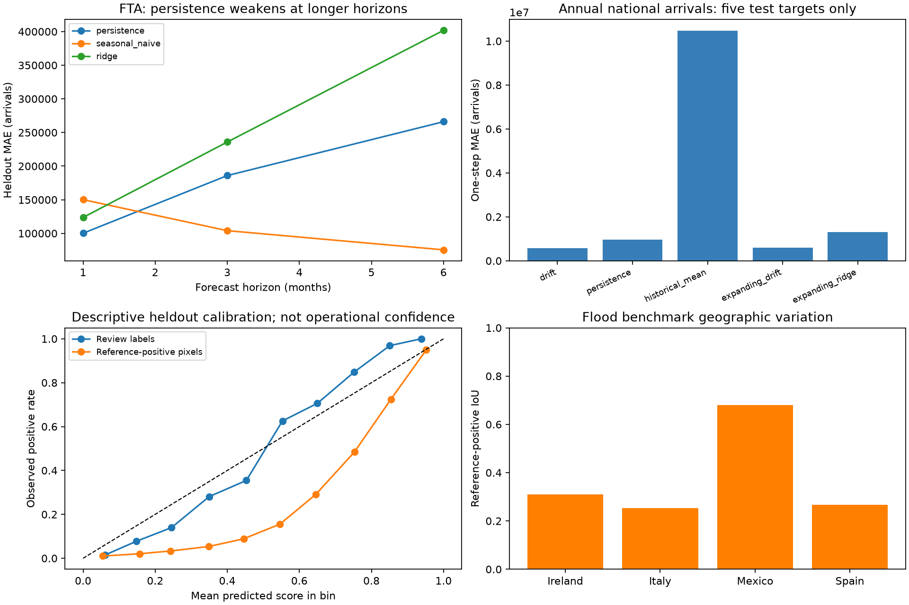

# SafarSaathi Phase 3 research validation

## 1. Project overview
SafarSaathi remains a local research prototype using historical national tourism/environment series, source-domain reviews, a preprocessed flood benchmark, static GIS and native satellite archives. Existing UI design and model artifacts are preserved; this work establishes bounded evidence, not operational readiness.

## 2. Research objectives
Audit six pipelines, reproduce appropriate metrics/baselines, check native GIS/image provenance, verify the Nepal event, test capacity arithmetic, implement genuine seeded GA/PSO, and expose only supported research functions. VERIFIED means the stated check was executed; EXPERIMENTAL and EXPLORATORY identify assumptions and retrospective analysis. Unsupported claims and future work remain explicit.

## 3. Dataset inventory
Baseline contains 2,561 file stat records. Model inventories retain artifact/source hashes, feature/target schemas and periods. Annual observed arrivals end in2019 despite later null source dates. Regional Uttarakhand satellite scenes do not cover a2026 Nepal event. No raw datasets were edited; preservation scope and exact changes are in CHANGE_MANIFEST.json.

## 4. Six-model evaluation
VERIFIED: all six stored metric sets reproduced. NLP accuracy0.8500, macro-F1 0.8495, ROC-AUC0.9249, PR-AUC0.9251. Flood precision0.3302, recall0.8372, Dice0.4736, IoU0.3103;42tiles/sevenevents/fourcountries. National annual/monthly/cyclone/PM2.5 metrics and denominators are in model_validation/MODEL_COMPARISON.csv. PM2.5 R²−0.9188 is a material weakness. Calibration bins/residuals are descriptive; no calibrated operational confidence claimed.

## 5. Baseline comparison
NLP majority accuracy0.5245. Annual drift one-step MAE578,589 versus persistence961,400 on five test targets. Monthly persistence one-month MAE100,187 versus seasonal150,104, but six-month MAE266,022 versus seasonal75,519. EXPLORATORY: seasonal baseline is substantially stronger at the longer horizon on this known period. No model was promoted by selecting on the test set. [Executed comparisons](model_validation/MODEL_EVALUATION_REPORT.md).



## 6. Geospatial validation
Native longitude/latitude validity, WGS84 ellipsoidal checks, local AEQD metric proximity, clipped OSM shared-node connectivity and coordinate/grid displacement are documented in geospatial/. Source POWER points are not attraction boundaries. Static OSM hospitals are tags/proxies, not verified operating facilities; connectivity does not establish routing. The frontend map remains schematic. Hazard polygons and field reference data are missing.

## 7. Rasuwagadhi case study
VERIFIED event date/corridor:26August2026, BhoteKoshi/Rasuwa, based on the [Nepal Ministry of Home Affairs appeal](https://www.moha.gov.np/en/post/ha-ra-tha-ka-apa-l-11) and [ICIMOD preliminary report record](https://lib.icimod.org/records/qdvc1-tc123). ICIMOD describes a cascading rock/ice/debris process; no conventional GLOF classification is inferred. Quantitative model validation NOT EVALUATED: no aligned event imagery/reference masks, closures or tourist panel. Inaccessible PDF material is not treated as inspected evidence. See flood_case_study/ for source ledger and limitations.

## 8. Scenario validation
VERIFIED arithmetic on21controlled sensitivity cases, independent formula checks, deterministic replay and conservation. Demand, base load, capacity and availability effects are recorded in scenario_validation/. EXPERIMENTAL capacity pressure does not model rainfall, landslide mechanics, evacuation or casualties. Unsupported physical parameters are rejected.

## 9. GA/PSO evaluation
EXPERIMENTAL genuine tournament/blend/mutation/elitist GA and inertia/cognitive/social PSO. Capped-simplex repair enforces continuous nonnegative allocation and demand conservation within minimum effective/road/resource capacities.18primary seeded experiments, exact allocation/trace replay and six budget checks; maximum capacity violation0, largest numerical-reference gap about4.68e−7 objective units on the explicit fixture. Both algorithms retain a proportional-capacity baseline. Exposure weights are assumptions, not learned benefits. No global optimum, causal gain or empirical algorithm superiority is claimed. See optimization/ and formulation_v1 metadata/API.

## 10. Satellite validation
Native raster checksums, header dimensions, delivered product identities, sensing dates, coverage and pilot intersections are audited. Sentinel-1 VV/VH GRD source has GCP tiepoints without affine registration: terrain/radiometric correction and co-registration remain required. Sentinel-2 wrapper/actual processing baselines differ; SCL cloud classification is checked against suspicious zero-cloud metadata. Unreadable quality layers are flagged. No raw-scene flood accuracy or cloud-free ground claim follows from integrity. See satellite_validation/ for actual counts and denominator definitions.

## 11. End-to-end results
Baseline153backend+9frontend tests/build/lint passed before edits. Final machine-readable results and connection statuses are in end_to_end/END_TO_END_TEST_REPORT.md and SYSTEM_VALIDATION_MATRIX.csv. The empirical hazard→geospatial exposure→digital twin→intervention chain is UNSUPPORTED because aligned inputs/target validation are absent. Separately, hypothetical allocation→HTTP→recomputed JSON report is tested. Unit tests do not imply browser or scientific event validation.

## 12. Reproducibility
Run the scripts/commands in benchmarking/REPRODUCIBILITY_GUIDE.md. EXPERIMENT_REGISTRY.csv records actual models/baselines/horizons, scenarios and seeded optimizers. Exact hashes, configurations, predictions and limitations are retained in JSON/CSV. CHANGE_MANIFEST.json lists exact created/modified paths, unchanged-artifact checks and raw inventory preservation scope. No retraining or raw downloads were performed.

## 13. Limitations
Known test periods have been revisited; no new untouched prospective evaluation. Sparse annual/event samples, spatial correlation, source-domain labels, national/local scale mismatch, missing Nepal aligned references and uncertain infrastructure status limit generalization. Neither optimizer nor scenario proxies validate actual hazard, emergency action or intervention effectiveness. N/A live telemetry remains correct. Scientific validation is incomplete wherever essential reference data are missing.

## 14. Future research directions
FUTURE WORK: obtain authorized event-aligned registered Sentinel scenes and target-compatible independent masks; validate geographic registration and local infrastructure; assemble local temporal demand/exposure observations; reserve untouched time/event/spatial splits; assess horizon-specific forecast selection and calibrated intervals; validate intervention costs/outcomes before operational optimization. Use prospective evaluation to decide model promotion rather than this retrospective test comparison.

## Executed release evidence

```json
{
  "backend": {
    "tests": 181,
    "failures": 0,
    "errors": 0,
    "skipped": 0
  },
  "frontend": {
    "passed": 9,
    "failed": 0,
    "skipped": 0,
    "evidence": "frontend_tests.log"
  },
  "geospatial": {
    "checks_passed": [
      "finite/ranged coordinate acceptance and invalid rejection",
      "ellipsoidal zero and known one-degree longitude distance",
      "native lon-lat pilot geometry validity/containment",
      "shared-node component union/find"
    ],
    "status": "PASS",
    "coordinate_rows": 29,
    "all_native_points_valid": true,
    "all_query_points_valid": true,
    "source_md5_match": true,
    "satellite_checksum_mismatches": 0,
    "runtime_seconds": 310.29969189999974
  },
  "models_changed": [],
  "raw_stat_changes": 0
}
```

Exact deliverable and change paths: [CHANGE_MANIFEST.json](CHANGE_MANIFEST.json). Browser actions/results: [BROWSER_VERIFICATION.md](end_to_end/BROWSER_VERIFICATION.md). The 181 backend and9 frontend counts refer to this run; they are not predictions for a different installation.
