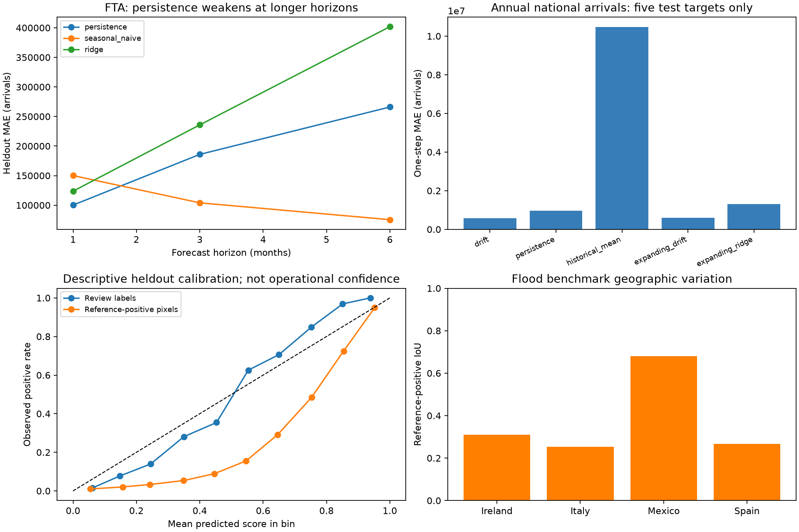

# Research benchmark

The experiment registry combines actual model/baseline/horizon results, 21 scenario cases and 18 seeded optimizer experiments. Dataset and artifact hashes, seed/configuration, evaluation scope and limitations are retained without converting proxy objectives into empirical accuracy.

NLP materially exceeds its dummy baseline. Annual one-step drift outperforms persistence on five targets. Monthly longer-horizon seasonal-naive is substantially better on the known holdout; no model promotion follows from selecting against this test set. Flood geographic performance varies and precision is low. PM2.5 R² is negative. GA and PSO satisfy this small hypothetical convex problem, but no claim of algorithmic superiority follows from one fixture. Numerical-reference gaps, repeatability, exposure/utilization components, wall times and seed variation are preserved in ../optimization/OPTIMIZATION_COMPARISON.csv. Satellite header/integrity and OSM proximity audits are data checks, not predictive benchmarks.

No full raw-scene or Nepal event benchmark exists. These missing experiments are recorded as unsupported rather than assigned fabricated metrics.
