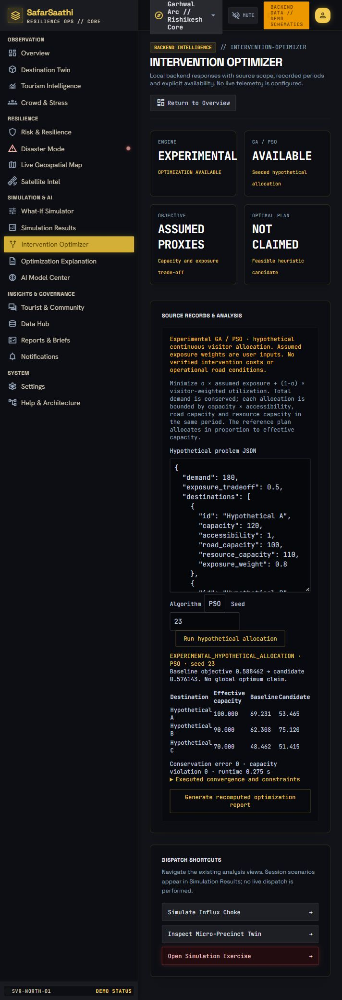

# Browser verification, 2026-10-30

The updated Python API was started on127.0.0.1:8000 and the existing Vite preview on127.0.0.1:5173. An initially unavailable preview was restarted; no cached earlier session was treated as current evidence. The isolated8011 API was used for the9 frontend integration tests.

Executed in the in-app browser:

- Opened Launch Command Deck → Intervention Optimizer. The metadata response displayed ENGINE EXPERIMENTAL / OPTIMIZATION AVAILABLE and explicitly hypothetical assumptions.
- Submitted the displayed three-destination hypothetical fixture with180 visitor equivalents, alpha0.5, seed23, population16 and30iterations using GA. Baseline objective0.588462 → candidate0.576143. Allocations53.45132829431658,75.11999903681476,51.428672668868664; conservation error0 and capacity violation0.
- Generated the report using the actual UI button. Read the downloadable report link payload and confirmed status EXPERIMENTAL_HYPOTHETICAL_ALLOCATION, GA, the same allocations and conservation error0. Report recomputation is additionally asserted by the HTTP regression test.
- Selected PSO and submitted. The UI displayed PSO seed23, baseline0.588462 → candidate0.576143, allocations rounded53.465,75.120,51.415 and zero conservation/capacity violations. This fixture differs from the primary benchmark fixture; these browser values must not be merged as if they were the same experiment.
- Opened AI Model Center and verified the generated research findings appeared, including historical-holdout scope, weak long-horizon monthly forecasts, negative PM2.5 R², low flood precision and missing aligned Nepal evidence.

The numerical values are API results, not hardcoded result cards. UI controls begin with clearly labeled hypothetical input. Original schematic/demo content elsewhere remains labeled; its telemetry is not scientifically validated by these actions. No claim is made that a live local hazard→twin→optimization chain exists.
