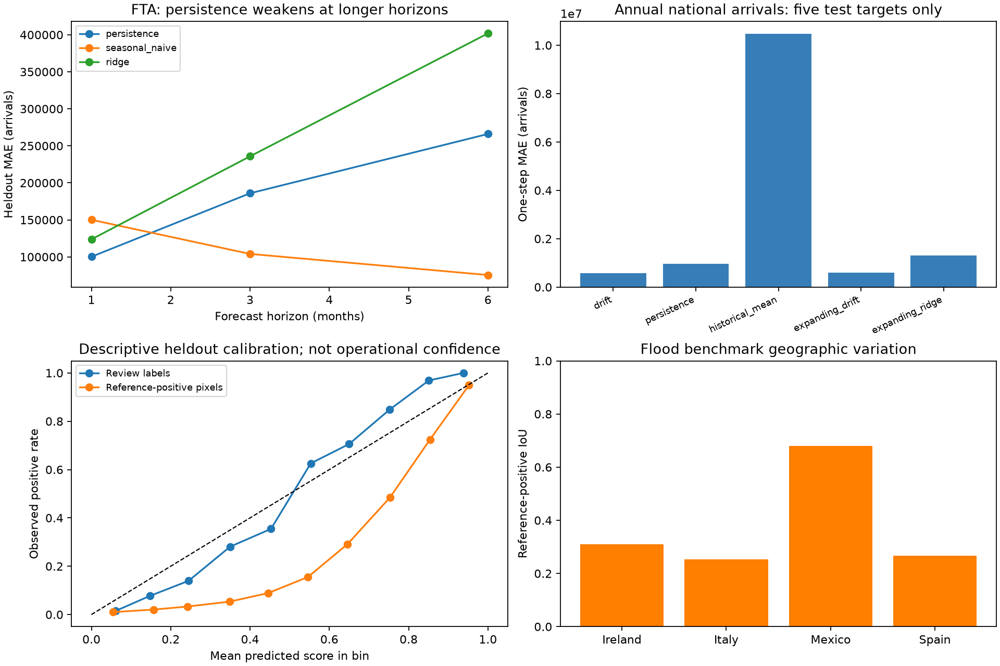

# Six-model evaluation

All six stored metric sets were reproduced. This is historical holdout replay, not prospective certification. Models and raw data remain unchanged.



| Model | Algorithm | Stored metrics reproduced |
|---|---|---|
| nlp-20261024T182952Z | Pipeline(steps=[('tfidf',                  TfidfVectorizer(max_features=30000, min_df=2,                                  ngram_range=(1, 2))),                 ('classifier',                  LogisticRegression(max_iter=1000, random_state=20261024))]) | True |
| tourism_demand_forecaster | Frozen drift estimator for original holdout; final inference drift refit through 2019 | True |
| tourism_monthly_fta_forecaster | persistence | True |
| north_indian_cyclone_count_forecaster | seasonal_mean | True |
| india_pm25_exposure_forecaster | ridge | True |
| flood_segmentation_model | HistGradientBoostingClassifier(class_weight='balanced', l2_regularization=1,                                max_iter=80, max_leaf_nodes=15,                                random_state=20261025) | True |

Full precision metrics, denominators, per-horizon baselines and residual quantiles: [MODEL_COMPARISON.csv](MODEL_COMPARISON.csv), [evaluation_results.json](evaluation_results.json). Positive-class confusion matrices and calibration bins are retained in the JSON; predictions are separate CSVs.

NLP accuracy 0.8500 and macro-F1 0.8495 exceed the training-majority accuracy 0.5245. ROC-AUC 0.9249, PR-AUC 0.9251, Brier 0.1158 and 10-bin ECE 0.0786 describe the source holdout.

Annual one-step drift MAE 578,589 versus persistence 961,400 uses only five test targets. Monthly persistence performs well at one month (MAE 100,187 versus seasonal-naive 150,104), but at six months its MAE 266,022 is worse than seasonal-naive 75,519. The seasonal diagnostic therefore has about 71.6% lower error at six months on this known period. This does not authorize selecting a new production model on the test set. PM2.5 negative R² (−0.9188) rules out presenting its output as a strong explanatory forecast. Consult the CSV for cyclone count versus persistence/mean comparisons; archive counts are not local event probabilities.

Flood reference-positive precision 0.3302, recall 0.8372, Dice 0.4736 and IoU 0.3103 across 42 heldout tiles, seven events and four countries reveal substantial false positives and geographic variation. Permanent water is included in the target, so this is not event-specific temporary flood validation. Pooled pixel calibration is descriptive under spatial dependence.

No replacement artifact was promoted: additional untouched periods, external locations and adequate event counts are needed. Hardening rejects malformed model outputs without changing learned predictions.

## Forecast residual bands and validation scope

Bands use validation residuals only where available; they are exploratory, uncalibrated and may have very small samples. Coverage/width cannot be equated with operational assurance.

### tourism_demand_forecaster

```json
[
  {
    "horizon": 1,
    "validation_n": 5,
    "test_n": 5,
    "validation_absolute_residual_quantile_90": 5921571.428571428,
    "test_band_coverage": 1.0,
    "mean_band_width": 11843142.857142856,
    "status": "EXPLORATORY_FIXED_WIDTH_RESIDUAL_BAND_NOT_CALIBRATED_INTERVAL"
  },
  {
    "horizon": 2,
    "validation_n": 4,
    "test_n": 4,
    "validation_absolute_residual_quantile_90": 6094142.857142856,
    "test_band_coverage": 1.0,
    "mean_band_width": 12188285.714285713,
    "status": "EXPLORATORY_FIXED_WIDTH_RESIDUAL_BAND_NOT_CALIBRATED_INTERVAL"
  },
  {
    "horizon": 3,
    "validation_n": 3,
    "test_n": 3,
    "validation_absolute_residual_quantile_90": 6145714.2857142845,
    "test_band_coverage": 1.0,
    "mean_band_width": 12291428.571428569,
    "status": "EXPLORATORY_FIXED_WIDTH_RESIDUAL_BAND_NOT_CALIBRATED_INTERVAL"
  }
]
```

### tourism_monthly_fta_forecaster

```json
[
  {
    "horizon": 1,
    "validation_n": 12,
    "test_n": 24,
    "validation_absolute_residual_quantile_90": 144743.0,
    "test_band_coverage": 0.7916666666666666,
    "mean_band_width": 289486.0,
    "status": "EXPLORATORY_FIXED_WIDTH_RESIDUAL_BAND_NOT_CALIBRATED_INTERVAL"
  },
  {
    "horizon": 3,
    "validation_n": 10,
    "test_n": 22,
    "validation_absolute_residual_quantile_90": 441397.0,
    "test_band_coverage": 1.0,
    "mean_band_width": 882794.0,
    "status": "EXPLORATORY_FIXED_WIDTH_RESIDUAL_BAND_NOT_CALIBRATED_INTERVAL"
  },
  {
    "horizon": 6,
    "validation_n": 7,
    "test_n": 19,
    "validation_absolute_residual_quantile_90": 453564.0,
    "test_band_coverage": 1.0,
    "mean_band_width": 907128.0,
    "status": "EXPLORATORY_FIXED_WIDTH_RESIDUAL_BAND_NOT_CALIBRATED_INTERVAL"
  }
]
```

### north_indian_cyclone_count_forecaster

```json
[
  {
    "horizon": 0,
    "validation_n": 60,
    "test_n": 120,
    "validation_absolute_residual_quantile_90": 1.0,
    "test_band_coverage": 0.8083333333333333,
    "mean_band_width": 2.0,
    "status": "EXPLORATORY_FIXED_WIDTH_RESIDUAL_BAND_NOT_CALIBRATED_INTERVAL"
  }
]
```

### india_pm25_exposure_forecaster

```json
[
  {
    "horizon": 1,
    "validation_n": 7,
    "test_n": 7,
    "validation_absolute_residual_quantile_90": 4.159003536358043,
    "test_band_coverage": 1.0,
    "mean_band_width": 8.318007072716085,
    "status": "EXPLORATORY_FIXED_WIDTH_RESIDUAL_BAND_NOT_CALIBRATED_INTERVAL"
  }
]
```
